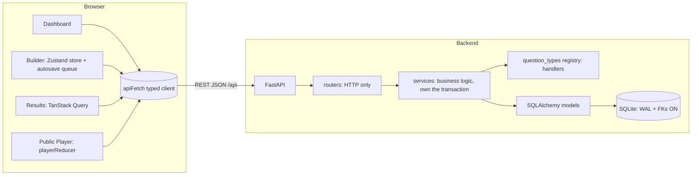
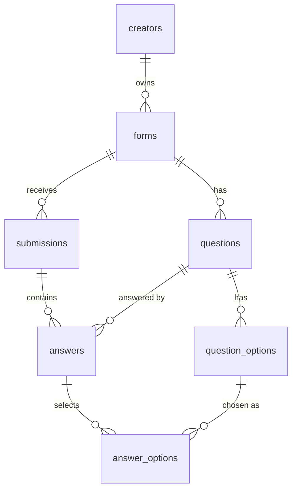

# Formly: Implementation Plan (v2, audited)

> **STATUS: PLANNING ONLY. Implementation has NOT started.**
>
> **Planning-stage rules**
> - While planning, the ONLY files that may be created or modified are `IMPLEMENTATION_PLAN.md` and `TASKS.md`.
> - No application code, no scaffolding, no dependency installation, no `VERIFICATION.md`.
> - Implementation begins ONLY after the human says explicitly: **"Proceed with implementation."** Phrases like "looks good", "okay", "continue" are NOT authorization.
> - `VERIFICATION.md` is created only at the very end of implementation (TASKS.md Phase 15), from real test and run results.

> **Authority and decision rule.** This plan (v2) supersedes `ANTIGRAVITY_BUILD_SPEC.md` wherever they differ, because v2 records audited corrections. Everything below is already decided. During implementation, do NOT re-debate or silently substitute decisions. If something is genuinely undecided, apply the simplest option consistent with this plan, log it in §25 as `A-<n>`, and continue. If it would change the stack, the DB schema, or the API contract, STOP and ask the human.

---

## 1. Project overview

**Formly** is a Typeform-style form builder and conversational form player.

- **Creators** (a single default demo creator, no login) build forms in a three-pane drag-and-drop builder, publish them to a shareable public URL, and read results (table, individual response, per-question stats).
- **Respondents** open `/f/<slug>` with no auth and answer one full-screen question at a time with animated transitions, keyboard navigation, and client + server validation.

The UI is *inspired by* Typeform's design language. Do not use Typeform's name, logo, proprietary assets, or any copied source code. The product name "Formly" is defined once in `frontend/src/lib/constants.ts`.

The two highest-priority deliverables are **(1) the builder** and **(2) the animated respondent player**. Database design and API design are explicitly evaluated.

## 2. Requirements breakdown (with traceability IDs)

`VERIFICATION.md` must map each ID below to an implementation and a real test/run.

| ID | Requirement |
|---|---|
| B1 | Form has a title and an ordered list of questions |
| B2 | Add, edit, delete questions |
| B3 | Drag-and-drop reorder (persisted, atomic) |
| B4 | 8 question types: short text, long text, multiple choice, dropdown, email, number, yes/no, rating |
| B5 | Per-question required toggle and description/help text |
| B6 | Live preview (WYSIWYG canvas + full-screen player preview) |
| B7 | Duplicate a question |
| B8 | Autosave with Saving / Saved / Failed indicator |
| F1 | Dashboard list with status (draft/published) and response count |
| F2 | Create form |
| F3 | Rename form |
| F4 | Duplicate form (deep copy) |
| F5 | Delete form (with confirmation) |
| F6 | Publish / unpublish with shareable public link |
| F7 | All form definitions persist |
| F8 | Dashboard search and status filter |
| P1 | One question at a time, full-screen, smooth direction-aware transitions |
| P2 | Keyboard navigation (Enter / arrows / letter, Y/N, digit keys) and progress indicator |
| P3 | Client-side validation |
| P4 | Server-side validation, independent of the client |
| P5 | Submit stores the response; thank-you screen |
| P6 | No login to fill a published form |
| R1 | Responses table (paginated) |
| R2 | Individual response view (drawer, deep-linkable) |
| R3 | Per-question summary statistics |
| R4 | Responses persist |
| X1 | Typeform-like look and feel |
| X2 | Toasts for every mutation outcome |
| X3 | Modals and inline editing |
| X4 | Settings placeholders (theme) + editable thank-you screen |
| D1 | Seed data (published forms + responses) |
| D2 | README |
| D3 | Deployment (Vercel + Render) readiness, then deployment |
| D4 | Database design quality |
| D5 | API design quality |

**Priority order (never invert):** 1) functional correctness, 2) DB persistence, 3) backend/API correctness, 4) builder quality, 5) respondent experience, 6) UI/UX polish, 7) testing, 8) documentation, 9) deployment readiness, 10) bonus.

## 3. Mandatory vs placeholder vs bonus

**Mandatory:** everything in §2.

**Placeholder ("Coming Soon", no functionality, minimal time):**

| Placeholder | Where it appears |
|---|---|
| Logic jumps / branching | "Logic" section in builder right panel |
| Integrations / webhooks | `/forms/[formId]/connect` page and tab |
| Team collaboration / sharing | Row in PublishModal |
| File upload & Payment question types | Disabled entries with a "Coming Soon" badge in the AddQuestionPopover |
| Theme (colors/fonts/background) | Disabled card in the Settings tab |
| Real authentication | Static "Demo Creator" avatar; backend `get_current_creator()` |

**Bonus (STRICTLY gated):** CSV export, completion rate / partial-response tracking, logic jumps, dark mode, custom themes, file upload. **No bonus work may start until Gates A, B, and C in §26 have passed and Phase 15 (VERIFICATION.md) is complete.** Bonus order: CSV export → completion rate → basic logic jumps → dark mode → custom themes → file upload.

## 4. Architecture



- All frontend pages are **client components** fetching from FastAPI. No Next.js API routes, no server actions, no Next-side DB access. Tiny exceptions: `next.config` redirects.
- Backend layering: `routers` (thin, HTTP only) → `services` (all business rules, receive a `Session`, commit explicitly) → `models`. `schemas` hold Pydantic request/response models. The `question_types` registry removes every `if type == ...` chain.
- Endpoints are plain `def` (not `async def`), so synchronous SQLAlchemy runs in FastAPI's threadpool and does not block the event loop.

## 5. Technology decisions (fixed)

| Area | Decision |
|---|---|
| Runtime | Node 20+ (installed: v25.9.0), npm; Python 3.11+ (installed: 3.13.1). See §24 risk R-1 |
| Frontend | **`npx create-next-app@15`** (pin major 15; do NOT let it install 16), React 19, TypeScript `strict: true` + `noUncheckedIndexedAccess`, App Router, `src/` dir, ESLint, no Turbopack flag requirement |
| Styling | **Tailwind CSS v4** (the default of create-next-app@15; tokens as CSS variables in an `@theme` block in `globals.css`; container queries are built in) |
| Primitives | Individual `@radix-ui/react-dialog`, `-dropdown-menu`, `-popover`, `-tooltip`, `-switch`, `-tabs`, wrapped in our own styled components. No other component library |
| Helpers | `lucide-react`, `sonner`, `clsx` + `tailwind-merge` (a `cn()` helper). No date library: use `Intl.RelativeTimeFormat` / `Intl.DateTimeFormat` |
| Animation | `motion` (Framer Motion, import from `motion/react`) |
| DnD | `@dnd-kit/core` + `@dnd-kit/sortable` + `@dnd-kit/modifiers` + `@dnd-kit/utilities` |
| Server state | `@tanstack/react-query` v5 |
| Builder state | `zustand` v5, via a **store factory** (see §12/§15) |
| Player state | Pure `useReducer` reducer produced by a factory |
| Fonts | `next/font/google`: Inter (app chrome), Karla (player) |
| Frontend tests | Vitest + jsdom + React Testing Library + `@testing-library/user-event` + `@testing-library/jest-dom`; Playwright (Chromium) for E2E |
| Lint/format | ESLint (`@typescript-eslint/no-explicit-any: error`), Prettier (+ tailwind plugin) |
| Backend | FastAPI, Pydantic v2, `pydantic-settings`, SQLAlchemy 2.0 (`Mapped[]` style, **sync** engine), Alembic, uvicorn; dev: pytest, httpx, ruff. No mypy |
| DB | SQLite (file), WAL, FKs ON |
| Backend deps style | `requirements.txt` + `requirements-dev.txt` in a `.venv`. Pin versions that provide Python 3.13 wheels |
| Deploy | Vercel (frontend), Render Docker web service + persistent disk (backend) |

`create-next-app` flags: `--typescript --eslint --tailwind --src-dir --app --use-npm --import-alias "@/*"`. After scaffolding, verify `next` is 15.x and `tailwindcss` is 4.x before continuing.

## 6. Reasons for each major decision

- **Zustand store factory (not a module singleton).** A global `create()` store would leak one form's state into the next form opened. The `[formId]` layout creates one store instance per form (`useRef` + React context, with `key={formId}` for a clean remount).
- **Zustand over Context.** Outline, canvas, settings panel, top bar, and preview all read the same in-progress definition and save status. Selector-based subscription avoids whole-tree re-renders while typing.
- **`useReducer` + factory for the player.** The state machine (phase, index, direction, answers, errors) is pure and unit-testable without React. The reducer needs the question list for validation, so it is created via `makePlayerReducer(questions)`.
- **TanStack Query for read-heavy screens** (dashboard, results, stats, public form): cache, invalidation, loading/error states. The builder uses Zustand plus its own write queue because it needs optimistic edits and ordered writes.
- **dnd-kit.** Accessible `KeyboardSensor` (also what makes E2E drag deterministic), `DragOverlay`, animated drop.
- **Framer Motion not on sortable rows.** To avoid dnd-kit transform vs. Framer `layout` conflicts, outline rows use NO Framer `layout` animation. dnd-kit owns row transforms. Framer is only used for the player slides, the progress bar, modal/drawer/popover entrances, and a simple fade-in on newly added rows.
- **Relational options + typed answers.** `question_options` and `answer_options` use real FKs so stats are `GROUP BY option_id` and stay correct when labels are edited. `answers` has typed columns (`value_text/number/bool`) instead of a JSON blob.
- **JSON only for `questions.config`** (type-specific scalars like `max`, `min`, `placeholder`). It varies by type, would otherwise need many sparse columns, and is validated by a per-type Pydantic model (`extra="forbid"`). `forms.theme` is JSON, reserved for the theme bonus.
- **Integer `position` with transactional resequencing** instead of fractional indexing: simple, explainable, and form sizes are small.
- **SQLite, WAL, `busy_timeout`.** Matches the assignment. WAL allows concurrent reads during a write. A single backend instance is assumed.
- **Hand-written TS API types** mirror the Pydantic schemas (explicit assumption A-1), reduced in risk by the shared contract-fixture file (§16).

## 7. Directory structure

```text
/                                   (repo root)
  ANTIGRAVITY_BUILD_SPEC.md         (existing; keep untouched)
  IMPLEMENTATION_PLAN.md  TASKS.md  VERIFICATION.md (created last)  README.md
  .gitignore  .editorconfig  .nvmrc (optional)
  contract/
    validation-cases.json           (shared client/server validation fixtures, §16)
  docs/screenshots/                 (README images)
  backend/
    app/
      main.py                       (app factory, CORS, middleware, handlers, router includes)
      core/  config.py  errors.py  security.py  limits.py
      db/    base.py (Base, naming convention)  session.py  types.py (UTCDateTime)
      models/  creator.py form.py question.py question_option.py submission.py answer.py answer_option.py
      schemas/ common.py form.py question.py submission.py stats.py public.py
      routers/ health.py forms.py questions.py submissions.py public.py
      services/ form_service.py question_service.py submission_service.py stats_service.py slug.py
      question_types/ base.py registry.py short_text.py long_text.py multiple_choice.py dropdown.py email.py number.py yes_no.py rating.py
      seed.py                       (python -m app.seed)
    alembic/ (env.py, versions/)  alembic.ini
    tests/   conftest.py  test_*.py
    requirements.txt requirements-dev.txt Dockerfile .env.example pyproject.toml (ruff/pytest config only)
  frontend/
    src/
      app/                          (routes only; thin) layout.tsx not-found.tsx error.tsx global-error.tsx
        page.tsx                                        (/)
        forms/[formId]/layout.tsx                       (shared top bar + store provider)
        forms/[formId]/create/page.tsx  settings/page.tsx  connect/page.tsx  results/page.tsx
        f/[slug]/page.tsx
      components/ ui/ dashboard/ builder/ player/ results/ placeholders/
      lib/ constants.ts  api/ (client.ts forms.ts questions.ts submissions.ts public.ts)
           question-types/ (registry.ts types.ts validators.ts + one folder per type)
           player/ (playerReducer.ts keyboard.ts progress.ts)
           store/ (builderStore.ts autosave.ts BuilderStoreProvider.tsx)
           utils/ (cn.ts dates.ts clipboard.ts)
      hooks/  types/ (api.ts)
    e2e/ (playwright specs + helpers)  playwright.config.ts  vitest.config.ts  vitest.setup.ts
    .env.example
```

## 8. Database schema

SQLite, integer autoincrement PKs. **All FKs `ON DELETE CASCADE`.** `PRAGMA foreign_keys=ON`, `journal_mode=WAL`, `busy_timeout=5000`, `synchronous=NORMAL` set on every connection via an engine `connect` event. Connect args: `check_same_thread=False`.

**Naming convention** (set on `Base.metadata`; REQUIRED so Alembic batch mode and CHECK constraints work on SQLite): `ix_%(column_0_label)s`, `uq_%(table_name)s_%(column_0_name)s`, `ck_%(table_name)s_%(constraint_name)s`, `fk_%(table_name)s_%(column_0_name)s_%(referred_table_name)s`, `pk_%(table_name)s`. Every CHECK must be given an explicit `name`.

**Timestamps:** SQLite drops timezone info. Use a custom `UTCDateTime` `TypeDecorator` (`db/types.py`) that stores naive UTC and returns tz-aware UTC datetimes, so Pydantic serializes ISO-8601 with `Z`.

| Table | Columns and constraints |
|---|---|
| `creators` | `id` PK; `email` TEXT UNIQUE NOT NULL; `name` TEXT NOT NULL; `created_at` |
| `forms` | `id` PK; `creator_id` FK→creators NOT NULL; `title` TEXT NOT NULL default 'Untitled form'; `description` TEXT NULL; `status` TEXT NOT NULL default 'draft' CHECK IN ('draft','published'); `slug` TEXT UNIQUE NOT NULL; `thank_you_title` TEXT NOT NULL default 'Thank you!'; `thank_you_message` TEXT NOT NULL default 'Your response has been recorded.'; `theme` JSON NOT NULL default `{}`; `published_at` NULL; `created_at`; `updated_at`. **CHECK `((status='published') = (published_at IS NOT NULL))`** |
| `questions` | `id` PK; `form_id` FK NOT NULL; `type` TEXT NOT NULL CHECK IN (the 8 keys); `title` TEXT NOT NULL default ''; `description` TEXT NULL; `required` BOOL NOT NULL default 0; `position` INT NOT NULL; `config` JSON NOT NULL default `{}`; `created_at`; `updated_at`. **No UNIQUE on (form_id, position)** (SQLite cannot defer it during bulk resequence; integrity is enforced in the service layer inside one transaction) |
| `question_options` | `id` PK; `question_id` FK NOT NULL; `label` TEXT NOT NULL (may be empty in drafts); `position` INT NOT NULL |
| `submissions` | `id` PK; `form_id` FK NOT NULL; `status` TEXT NOT NULL default 'completed' CHECK IN ('in_progress','completed'); `started_at` NOT NULL; `submitted_at` NULL. MVP writes only `completed` with `started_at = submitted_at = now` |
| `answers` | `id` PK; `submission_id` FK NOT NULL; `question_id` FK NOT NULL; `value_text` TEXT NULL; `value_number` REAL NULL; `value_bool` BOOL NULL. UNIQUE(`submission_id`,`question_id`). **CHECK at most one `value_*` non-null.** Choice/dropdown answers have all three NULL and use `answer_options`. Skipped optional questions have NO row |
| `answer_options` | `answer_id` FK NOT NULL; `option_id` FK→question_options NOT NULL; composite PK (`answer_id`,`option_id`) |

**Indexes:** `forms(creator_id, updated_at)`; unique `forms(slug)`; `questions(form_id, position)`; `question_options(question_id, position)`; `submissions(form_id, submitted_at)`; `answers(question_id)` (stats); `answer_options(option_id)` (stats and cascade lookups). A separate `answers(submission_id)` index is unnecessary because the UNIQUE constraint's index has it as its prefix (document this).

**Deletion behavior:** form → questions, options, submissions, answers, answer_options. Question → its options and answers. Option → its `answer_options` rows. Relationships use `ondelete="CASCADE"` + `passive_deletes=True` so the DB performs the cascade; tests verify with raw SQL counts.

**Deleted-option cleanup:** deleting an option removes its `answer_options` rows via cascade; the service then deletes any `answers` row of that question left with zero options (otherwise a phantom "answered" row would skew stats). Historical answers for a deleted option are lost (assumption A-9; the UI warns when responses exist).

**Cross-table integrity not expressible as an FK** (answer's question belongs to the submission's form; option belongs to the answer's question) is enforced in the submission service and covered by tests. A composite-FK design was rejected as over-engineered.

**JSON mutation:** always assign a new dict to `config`/`theme` (never mutate in place) so SQLAlchemy detects the change.

**Slug:** 8 chars, lowercase `a-z0-9`, via `secrets.choice`, generated at form creation, retried up to 5 times on collision, never changes. Seed slugs are fixed: `demo-feedback`, `demo-event`, `demo-waitlist`.

**Migrations:** Alembic with `render_as_batch=True`, `compare_type=True`, naming convention imported from `Base`. One reviewed initial migration. Do not run PRAGMA-dependent logic inside migrations.

## 9. Entity relationships



## 10. API specification

Prefix `/api`, JSON, no trailing slashes anywhere (`FastAPI(redirect_slashes=False)`; the client never adds one). Docs at `/api/docs`, schema at `/api/openapi.json`. `GET /api/health` → `{"status":"ok"}` after a `SELECT 1`.

**Route declaration order:** declare `PUT /forms/{id}/questions/reorder` before any `/{qid}` route. Path-parameter type errors (e.g. `/api/forms/abc`) map to **404 NOT_FOUND**, not 422.

### 10.1 Error format (ALL errors, including Pydantic/request validation mapped into it)

```json
{ "error": { "code": "VALIDATION_ERROR", "message": "Human readable summary",
             "fields": [ { "question_id": 12, "code": "REQUIRED", "message": "Please fill this in" } ] } }
```

`fields` is present only for validation-type errors: `question_id` for submission/publish errors, `field` (dotted path) for request-body errors. Server `message` values are generic English; the client renders its own copy keyed by `code` (§16).

| Status | Codes |
|---|---|
| 200 / 201 / 204 | success / created / no content |
| 404 | `NOT_FOUND`, `FORM_NOT_FOUND` (public: unknown AND unpublished slug return the identical body) |
| 413 | `PAYLOAD_TOO_LARGE` (>1 MB, Content-Length guard middleware) |
| 422 | `VALIDATION_ERROR`, `PUBLISH_VALIDATION_FAILED`, `QUESTION_TYPE_IMMUTABLE`, `REORDER_MISMATCH`, `QUESTION_LIMIT_REACHED` |
| 500 | `INTERNAL_ERROR` (generic message; details logged, never leaked) |

409 is unused in the MVP.

### 10.2 Field limits (enforced by Pydantic on the server; mirrored in the UI)

Form title 1–200 (trimmed, non-empty), form description ≤1000, thank-you title ≤200, message ≤2000. Question title ≤500 (may be empty), description ≤2000. ≤100 questions per form. ≤50 options per question, label ≤200 (may be empty in drafts). Rating `max` 3–10. Text `max_length` 1–10000; server-wide hard cap of 10000 chars for any text answer. Submission `answers` array ≤200 items.

### 10.3 Creator endpoints (scoped to the default creator; another creator's form → 404)

| Method + path | Request | Response |
|---|---|---|
| `GET /forms?q=&status=` | `q` case-insensitive title match (escape `%` `_`); `status` ∈ `draft`,`published` (anything else → 422) | 200 `FormSummary[]` ordered `updated_at DESC`: `id,title,status,slug,question_count,response_count,updated_at,published_at`. Counts via aggregate subqueries (no N+1). `response_count` counts `completed` submissions |
| `POST /forms` | `{title?}` | 201 `Form` (zero questions) |
| `GET /forms/{id}` | | 200 `Form`: all form columns + ordered `questions[]` each with ordered `options[{id,label,position}]` |
| `PATCH /forms/{id}` | any of `title, description, thank_you_title, thank_you_message` (`extra=forbid`: `slug`, `status` cannot be patched) | 200 `Form` |
| `DELETE /forms/{id}` | | 204 |
| `POST /forms/{id}/duplicate` | | 201 `Form` (draft, title `Copy of <title>` truncated to 200, new slug, deep-copied questions/options/config/thank-you fields/description, zero submissions, `published_at` null) |
| `POST /forms/{id}/publish` | | 200 `Form`; 422 `PUBLISH_VALIDATION_FAILED` |
| `POST /forms/{id}/unpublish` | | 200 `Form` (`status=draft`, `published_at=NULL`) |
| `POST /forms/{id}/questions` | `{type, title?, description?, required?, config?, options?, after_question_id?}` | 201 `Question`. Server fills type defaults: default config; choice/dropdown get options "Choice 1","Choice 2"; title defaults to `""`. `options` on a type without options → 422. `after_question_id` not in this form → 422 (field `after_question_id`). Over 100 questions → 422 `QUESTION_LIMIT_REACHED` |
| `PATCH /forms/{id}/questions/{qid}` | partial: `title, description, required, config, options, type?` (`extra=forbid`; `position` is NOT patchable) | 200 `Question` |
| `DELETE /forms/{id}/questions/{qid}` | | 204 (resequences) |
| `POST /forms/{id}/questions/{qid}/duplicate` | | 201 `Question`: deep copy (same title/description/required/config, new option rows) inserted directly after the original; later positions shift |
| `PUT /forms/{id}/questions/reorder` | `{ordered_ids: number[]}` | 200 `Question[]`; 422 `REORDER_MISMATCH` unless the ids exactly match the form's question ids (no missing, extra, or duplicate) |
| `GET /forms/{id}/submissions?page=1&page_size=25` | `page_size` ≤100 | 200 `{items,total,page,page_size}`; item `{id,submitted_at,status,answers:[{question_id,value}]}`; ordered `submitted_at DESC, id DESC`; `completed` only |
| `GET /forms/{id}/submissions/{sid}` | | 200 single item; sid not in this form → 404 |
| `GET /forms/{id}/stats` | | 200 `{total_responses,last_response_at,questions:[...]}` (§13.4). Zero responses returns zeros, never an error |

**PATCH semantics**
- `config`: replaces the whole config; validated by the type's `config_model` (`extra="forbid"`).
- `options`: the full ordered list `[{id?, label}]`. Existing ids updated, entries without id created, ids not in the list deleted (then deleted-option cleanup from §8). Foreign option ids → 422.
- `type` present: if different from the stored type → 422 `QUESTION_TYPE_IMMUTABLE`; if equal, accepted as a no-op.
- Any mutation to a form's questions/options/settings also bumps `forms.updated_at`.

**Publish validation** (`PUBLISH_VALIDATION_FAILED`, `fields` lists all offenders): form has ≥1 question (`field:"questions"`, code `NO_QUESTIONS`); every question title is non-empty after trimming (`QUESTION_TITLE_EMPTY`); every choice/dropdown question has ≥1 option (`OPTIONS_MISSING`) and no empty/whitespace labels (`OPTION_LABEL_EMPTY`). Publishing an already published form is idempotent (200). Unpublishing a draft is idempotent (200). Publishing sets `status` and `published_at`; the slug never changes.

**Published-form editing:** allowed and goes live immediately; no versioning and no extra server restriction (assumption A-5). The builder shows a "Changes are live" banner. The player renders an empty title as "Untitled question" and a published form that has zero questions shows "This form has no questions yet".

### 10.4 Public endpoints (no auth)

| Method + path | Behavior |
|---|---|
| `GET /public/forms/{slug}` | Published only, else 404 `FORM_NOT_FOUND` (identical body for unknown and unpublished). Header `Cache-Control: no-store`. Payload: `{slug,title,description,thank_you_title,thank_you_message,questions:[{id,type,title,description,required,config,options:[{id,label}]}]}`. No creator id, response counts, status, or timestamps |
| `POST /public/forms/{slug}/submissions` | Body `{answers:[{question_id, value}]}` (`extra=forbid`). 201 `{id}`. 404 if not published. **Validates EVERY stored question** against the stored definition (never trusts the client), collects ALL errors, returns them together as 422 `VALIDATION_ERROR` with `fields`. Validation happens fully BEFORE any write; the submission and all answers are written in ONE transaction |

### 10.5 Stats payload (per question)

`{question_id, type, answered_count, skipped_count, ...}` plus per type:
- `multiple_choice`, `dropdown`: `options:[{id,label,count,percentage}]` (all options, including zero counts). **`percentage` = count / `answered_count` ×100, 1 decimal.** For multi-select, percentages may sum above 100.
- `yes_no`: `options:[{label:"Yes",count,percentage},{label:"No",...}]`, same percentage rule.
- `rating`: `average` (2 decimals, null if no answers), `distribution:[{value,count}]` for `1..max(configured max, highest observed value)` including zeros.
- `number`: `min`, `max`, `average` (2 decimals; null when no answers).
- `short_text`, `long_text`, `email`: `recent:[string]` (latest 5 by submission time).

`skipped_count = total completed submissions − answered_count`. Only `completed` submissions are counted everywhere.

## 11. Frontend architecture

| Route | File | Notes |
|---|---|---|
| `/` | `app/page.tsx` | Dashboard |
| `/forms/[formId]` | `next.config` `redirects()` → `/forms/:formId/create` (non-permanent) | |
| `/forms/[formId]/create` | builder | |
| `/forms/[formId]/settings` | thank-you screen, welcome description, Theme placeholder | |
| `/forms/[formId]/connect` | "Coming Soon" | |
| `/forms/[formId]/results` | Tabs Summary / Responses via `?tab=responses`; drawer via `?response=<id>` | |
| `/f/[slug]` | public player | |

- **Next 15 specifics:** in client components read route params with `useParams()` (route `params` props are async Promises in Next 15; do not use them). Any component using `useSearchParams()` MUST be wrapped in `<Suspense>` or `next build` fails.
- `forms/[formId]/layout.tsx` is a client layout that creates the builder store, loads the form, renders the shared TopBar, and shows a skeleton while loading. A non-numeric or unknown `formId` renders a friendly "Form not found" page with a link to the dashboard.
- Global boundaries: `app/not-found.tsx`, `app/error.tsx`, `app/global-error.tsx`. Set `document.title` per page (client pages cannot export `metadata`).
- Root layout: fonts, `QueryClientProvider` (queries: `retry: 1` except on 4xx/network-handled cases; mutations: no retry; `refetchOnWindowFocus: false`), `<Toaster/>` (sonner, bottom-center, styled to tokens), Next `viewport` export with `interactiveWidget: 'resizes-content'`.
- **API client:** `apiFetch<T>()` in `lib/api/client.ts`. Base URL from `NEXT_PUBLIC_API_BASE_URL` (default `http://localhost:8000`). Throws `ApiError {status, code, message, fields}`. Non-JSON or 502/HTML responses → `code: "BAD_RESPONSE"`; fetch failures/abort → `status: 0, code: "NETWORK_ERROR"`; 30 s timeout via `AbortController`. 204 returns `undefined`.
- Types in `types/api.ts` mirror the Pydantic schemas (assumption A-1).
- Relative times and dates: `lib/utils/dates.ts` (Intl). Clipboard: `lib/utils/clipboard.ts` (`navigator.clipboard`, fallback to a selected-text `execCommand`, else a toast telling the user to copy manually).
- Dashboard tile colors: deterministic `PALETTE[form.id % 6]` (6 fixed soft colors defined in tokens).
- Icons (lucide): short_text `Type`, long_text `AlignLeft`, multiple_choice `ListChecks`, dropdown `ChevronsUpDown`, email `Mail`, number `Hash`, yes_no `ThumbsUp`, rating `Star`, file_upload `Upload`, payment `CreditCard`.

## 12. Builder architecture

**Store (`createBuilderStore()` factory + `BuilderStoreProvider`)** state: `form` (title, description, thank-you fields, status, slug), `questions[]` (each with `options[]`, where each option carries a client-only `clientKey = crypto.randomUUID()` and optional server `id`), `selectedId`, `saveStatus` (`saving|saved|failed`), `dirty`, `loadState`. Actions: `load`, `renameForm`, `updateFormSettings`, `addQuestion`, `updateQuestion`, `deleteQuestion`, `duplicateQuestion`, `reorderQuestions`, `select`, `setPublished`, `flush`, `flushAndWait`, `retry`. All components read through selectors, so outline, canvas, settings panel, and preview always stay synchronized (single source of truth; selection is by question id).

**Layout (≥1024 px), three panes under a top bar**
- **Top bar:** back arrow (awaits `flushAndWait()` then navigates), inline-editable form title (click to edit; Enter/blur commits; Escape cancels; empty commit reverts), SaveIndicator, tabs (Create | Settings | Connect | Results; links call `flushAndWait()` first), Preview button, Publish button (primary; becomes "Published" with a green dot and opens PublishModal).
- **Left outline:** numbered rows: drag handle, number, type icon, truncated title (placeholder "Your question here"), hover three-dot menu (Duplicate, Delete). Selected row highlighted. dnd-kit sortable with `DragOverlay` (lifted, shadowed copy), `restrictToVerticalAxis` + `restrictToParentElement`, `PointerSensor` (activation distance 5 px), `KeyboardSensor` (`sortableKeyboardCoordinates`). "Add question" button at the bottom opens `AddQuestionPopover` (searchable grid: 8 types + 2 disabled Coming Soon). **New questions are always appended at the end** (the API's `after_question_id` is used only by question duplicate) and immediately selected with the title focused.
- **Center canvas:** the selected question on a `#F7F7F7` surround, rendered in player styling. Title and description are borderless inline inputs (placeholders: type-specific `defaultTitle` for the title, "Description (optional)"). Below: the type's `CanvasPreview` (reuses the respondent input read-only). Choice/dropdown: options editable inline (edit label, add, remove with min 1 enforced only at publish; drag-reorder of options is NOT required). Empty form: centered "Add your first question" prompt.
- **Right settings panel:** read-only type label, **Required** switch, the type's `ConfigPanel` (placeholder, max length, number min/max, rating scale, allow-multiple), and a "Logic" `ComingSoon` section. Invalid configs (e.g. min>max) show inline errors and are NOT sent (local validation) until fixed.
- **Below 1024 px:** outline becomes a toggled left drawer and settings a bottom sheet. A pixel-perfect mobile builder is not required; dashboard, results, and player must be fully responsive.

**Selection rules:** after delete, select the next question, else the previous, else none. `?question=<id>` on the create route selects that question on load (used by publish-failure navigation).

**Delete confirmation:** a confirm modal for question delete (warns about lost answers when the form has responses; the form's `response_count` is known from the list/stats cache or by a lightweight check of the form summary).

**Preview:** `Preview` runs `flushAndWait()` then opens a full-screen Radix Dialog overlay hosting the real `FormPlayer` with `mode="preview"` against a snapshot of the in-memory definition, with a Desktop/Mobile toggle (mobile = 390 px wide container; the player uses container queries so the mobile layout applies), "Preview" ribbon, close button. Preview never calls the server; its thank-you screen offers "Restart".

**Settings tab:** editable thank-you title/message (autosaved through the same store; live mini-preview), welcome-screen description (persisted), Theme card (swatches + font select disabled, "Coming Soon").

**PublishModal:** unpublished → explanation + Publish button; on 422 lists offending questions (click selects it) and the builder selects the first offender plus a toast. Published → public URL `<window.location.origin>/f/<slug>`, `Copy link` (toast "Link copied"), `Open form` (new tab), `Unpublish` (confirm), "Team collaboration" row with Coming Soon.

## 13. Question-type architecture (identical concept on both sides)

### 13.1 Backend
`question_types/base.py`: abstract `QuestionTypeHandler` with `type_key`, `config_model` (Pydantic, `extra="forbid"`), `default_config()`, `supports_options`, `validate_config(raw) -> dict`, `validate_answer(question, raw) -> NormalizedAnswer | None` (None = skipped; raises `AnswerValidationError(code)`), `persist_answer(db, answer_row, normalized)`, `read_answer(db/answer_row) -> JSON value`, `format_answer(question, value) -> str`, `aggregate_stats(db, question) -> dict`. `registry.py` maps `type_key → handler`. **Services and routers only call the registry; no `if type ==` anywhere.** Unknown type → 422.

### 13.2 Frontend
`lib/question-types/registry.ts` maps `type → QuestionTypeDefinition`: `type, label, icon, description, defaultConfig, defaultTitle (placeholder text only), ConfigPanel, CanvasPreview, RespondentInput, validate(question, value) → ErrorCode | null, isEmpty(value), serialize(question, value) → wire value | null, formatAnswer(question, value) → string, AnswerView, StatView`. A unit test asserts every one of the 8 types implements every member. Builder, player, and results iterate the registry and never branch on type. File upload and Payment are listed in a separate `PLACEHOLDER_TYPES` array (disabled in the picker, never in the registry).

### 13.3 Per-type behavior

| Type | Respondent UI | Wire value | Config (server model) | Server/client rules |
|---|---|---|---|---|
| short_text | single-line large underline input | string | `placeholder?`, `max_length?` | `REQUIRED`, `TOO_LONG` (length in Unicode code points) |
| long_text | auto-growing textarea; Enter advances, Shift+Enter newline; hint "Shift ↵ to make a line break" | string | `placeholder?`, `max_length?` | same |
| multiple_choice | lettered cards A, B, C…; letter keys select; single-select auto-advances after 400 ms; `allow_multiple` → checkmarks, requires OK/Enter | `number[]` option ids | `allow_multiple` (bool, default false) | `REQUIRED`, `INVALID_OPTION` (foreign/duplicate id), `TOO_MANY_OPTIONS` (>1 when not multiple) |
| dropdown | custom ARIA combobox/listbox (type to filter, arrows, Enter to pick); no extra dependency | `number[]` length ≤1 | `placeholder?` | `REQUIRED`, `INVALID_OPTION`, `TOO_MANY_OPTIONS` |
| email | email input | string | `placeholder?` | `REQUIRED`, `INVALID_EMAIL` |
| number | text input with `inputMode="decimal"` (NOT `type=number`; invalid text must be distinguishable from empty) | number | `placeholder?`, `min?`, `max?` (min ≤ max) | `REQUIRED`, `INVALID_NUMBER`, `NUMBER_TOO_SMALL`, `NUMBER_TOO_LARGE`. Accept `.` decimals only |
| yes_no | two large buttons; Y/N keys; auto-advance | boolean | none | `REQUIRED`, `INVALID_TYPE` |
| rating | row of stars (click or digit keys); auto-advance | integer | `max` 3–10 (default 5) | `REQUIRED`, `INVALID_RATING` (1 ≤ v ≤ max, integer) |

Auto-advance never fires on the LAST question (the Submit button is used instead), and any pending auto-advance timer is cancelled by further interaction, navigation, or unmount. Digit keys select values 1–9; when `max = 10`, key `0` selects 10.

### 13.4 Storage and serialization
text/email → `value_text` (trimmed); number → `value_number`; rating → `value_number` (read back as int); yes_no → `value_bool`; choice/dropdown → `answer_options` rows. `serialize` on the client converts player state (e.g. the raw number string) to the wire value; empty → `null`.

## 14. Respondent-flow architecture (HIGHEST PRIORITY)

One `FormPlayer` component serves `mode="live"` (public route) and `mode="preview"` (builder). It NEVER renders all questions at once. Root element is `relative h-full w-full overflow-hidden` (the public page wraps it in `h-dvh`; the preview wraps it in a sized container). The progress bar and nav cluster are `absolute` inside the root, NOT `fixed`, so preview containers work. Responsive styling uses **container queries** (not viewport media queries) so the Mobile preview is accurate.

### 14.1 Reducer (`lib/player/playerReducer.ts`, pure)
`makePlayerReducer(questions)` returns the reducer. State: `phase: 'welcome'|'question'|'submitting'|'done'`, `index`, `direction: 'forward'|'backward'`, `answers: Record<questionId, AnswerValue>`, `errors: Record<questionId, ErrorCode>`, `submitError: null | {kind:'network'|'server'|'stale'}`. Actions: `START`, `SET_ANSWER`, `NEXT`, `PREV`, `SUBMIT_SUCCESS`, `SUBMIT_FAILURE`, `RESTART`, `CLEAR_ERROR`.
- `NEXT` validates the current question via the registry. Invalid → sets `errors` and stays. Valid and not last → `index+1`, `direction: forward`. Valid and last → `phase: 'submitting'` (preview mode skips directly to `done`).
- `PREV` never validates; `direction: backward`; disabled at index 0. Answers persist across back/forward.
- A `useEffect` on `phase === 'submitting'` performs the POST (live mode only), then dispatches `SUBMIT_SUCCESS` or `SUBMIT_FAILURE` with mapped field errors.
- `SUBMIT_FAILURE`: 422 with fields for known questions → jump to the FIRST errored question, set server errors (server error messages use the client's copy for the code). 422 referencing a question id not in the loaded definition (UNKNOWN_QUESTION, or REQUIRED for a question the client never had) → `submitError.kind='stale'`: banner "This form was updated. Please reload." with Reload button. 404 → full-screen "This form is not available". Network/5xx → banner "Something went wrong. Your answers are saved on this page. Try again." with Retry; answers retained.
- Submit is guarded against double submission (ignored while `submitting`; button disabled).

### 14.2 Screens and layout
- **Welcome:** title, description, `Start` button with "press Enter ↵" hint, "Takes about N minute(s)" where N = max(1, ceil(questions × 15 / 60)).
- **Question slide:** question number + arrow icon in accent color; title (required → trailing `*`; empty title → "Untitled question"); description beneath in muted color; the type's `RespondentInput`; `OK ✓` button with "press Enter ↵" hint (hidden on touch devices via `(hover: none)`); on the last question the button reads `Submit`.
- **Chrome:** thin top progress bar: `progress = index / N` on question screens, 0 on welcome, 100% on submitting/done. Bottom-right up/down chevrons (up disabled on the first question; down validates like Enter). Bottom-left counter `3 of 8`. No third-party branding. Content max-width ~720 px, left aligned on desktop, generous padding on mobile; slide content scrolls (`overflow-y-auto`) when taller than the viewport.
- **Thank-you:** animated check, the form's thank-you title and message.
- **Public route states:** loading skeleton; 404 → "This form is not available" full-screen; network error → retry state; zero questions → "This form has no questions yet". Preview mode never calls the server.

### 14.3 Transitions
Direction-aware: forward = current exits up with fade, next enters from below with fade; backward = reversed. Duration 350 ms, easing `cubic-bezier(0.22, 1, 0.36, 1)`. Implementation: `AnimatePresence initial={false} custom={direction} mode="sync"` with slides `absolute inset-0`, so exit and enter overlap (a `wait` mode would double the perceived duration). The exiting slide is `inert`, `aria-hidden`, and `pointer-events-none`. An input lock (~350 ms) blocks duplicate advances from key repeat. The incoming slide's primary control auto-focuses after the enter transition finishes. `MotionConfig reducedMotion="user"` plus explicit handling: fade only, no shake.

### 14.4 Keyboard (`lib/player/keyboard.ts`, a pure, unit-tested `shouldHandleKey`/`mapKey` guard)
A single `keydown` listener (registered by FormPlayer on `document`, removed on unmount) which ignores: `event.isComposing` (IME), `event.repeat`, events with meta/ctrl/alt modifiers, events when a Radix dialog/popover is open, and Enter when the event target is a `button`, `a`, `select`, or `[role=option]` (these handle their own activation, which prevents double-advance).

| Key | Behavior |
|---|---|
| Enter | Advance with validation. Long text: Shift+Enter inserts a newline. Open dropdown: select highlighted option; closed dropdown with a value: advance. Welcome: start |
| ArrowDown / PageDown | Advance with validation, unless the focused control consumes it (open dropdown list; textarea caret movement) |
| ArrowUp / PageUp | Go back without validation, same exceptions |
| A–Z | Select the lettered option (multiple choice) when focus is not in a text input |
| Y / N | yes_no |
| 1–9 (and 0 for 10) | rating |

Focus rings are visible; interactive elements carry ARIA roles (`radiogroup`/`radio` for yes/no, rating and single-select choice; `checkbox` group for multi-select; `combobox`/`listbox` for dropdown); validation errors are announced via `aria-live="polite"`.

### 14.5 Validation UX
Client validators run on advance. Failure: brief slide shake (disabled under reduced motion), inline error with icon beneath the input, navigation blocked. Required-empty checks use `isEmpty`, which MUST treat `false` (yes/no) and `0` (number) as NON-empty.

## 15. State-management approach

| Concern | Tool |
|---|---|
| Dashboard list, results, stats, public form fetch | TanStack Query (`staleTime: 0` for results/stats; mutations invalidate `['forms']`, `['stats', id]`, `['submissions', id, ...]`) |
| Builder (definition, selection, save status, dirty tracking) | Zustand store (one instance per form via factory) |
| Player | `useReducer(makePlayerReducer(questions))` |
| Transient UI (modals, popovers, drawers) | local `useState` |
| Core data persistence | Backend/DB only. **No localStorage as source of truth** (not even for drafts) |

## 16. Validation strategy

**Single rule set, two implementations, one shared fixture file.** `contract/validation-cases.json` (repo root) holds cases `{type, config, options?, required, value, expected: null | ErrorCode}` per type. pytest iterates the file against the backend handlers and Vitest iterates it against the frontend validators, which is how rule parity is enforced. Edge cases that MUST be in the file: number `0` valid when required; yes_no `false` valid when required; empty string / whitespace for required text; boolean passed to number or rating → `INVALID_TYPE`/`INVALID_RATING`; rating `3.5`, `0`, `max+1`; number below min/above max; `NaN` and Infinity rejected on the server (`math.isfinite`); emoji-length text vs `max_length` (the client counts code points via `[...value].length`); foreign and duplicate option ids; two ids on single-select; email variants.

**Rules shared by both sides**
- Email: trimmed, ≤254 chars, regex `^[^\s@]+@[^\s@]+\.[^\s@]+$` (identical string on both sides).
- Emptiness: `null`, empty/whitespace string (text/email), empty list (choice/dropdown). Not empty: `false`, `0`.
- Order of checks: shape → emptiness (REQUIRED or skipped) → type rules. Optional + empty = skipped (no answer row).

**Error codes and client copy:** `REQUIRED` "Please fill this in"; `INVALID_TYPE` "That answer isn't valid"; `TOO_LONG` "Maximum N characters"; `INVALID_EMAIL` "Please enter a valid email"; `INVALID_NUMBER` "Please enter a number"; `NUMBER_TOO_SMALL` "Minimum value is X"; `NUMBER_TOO_LARGE` "Maximum value is X"; `INVALID_OPTION` "Please choose a valid option"; `TOO_MANY_OPTIONS` "Please choose only one option"; `INVALID_RATING` "Please choose a rating from 1 to N"; `UNKNOWN_QUESTION`; `DUPLICATE_ANSWER`.

**Server-only submission checks:** published form; every `question_id` belongs to the form (else `UNKNOWN_QUESTION`); no duplicate `question_id` (`DUPLICATE_ANSWER`); every required question answered; all errors collected together; nothing written unless all pass.

## 17. Autosave strategy (exact behavior)

- **Local first:** any edit (title, description, config, options, required, form title/settings) updates the Zustand store immediately and merges the changed fields into the dirty bucket for that entity (`form` or `question:<id>`). One 600 ms debounce timer for the whole store restarts on every edit.
- **One serialized write queue per store** (a promise chain) carries ALL writes: debounced PATCH flushes and structural operations. This makes ordering deterministic and removes overlapping-save races.
- **Flush:** on timer expiry (or `flushNow()`), snapshot-and-clear the dirty buckets, then enqueue one PATCH per dirty entity, built from changed fields only (`options` is sent as the FULL list when any option changed; `config` as the full config when any key changed). Edits made while a save is in flight go into fresh dirty buckets and are flushed afterward.
- **Structural ops** (`addQuestion`, `deleteQuestion`, `duplicateQuestion`, `reorderQuestions`) bypass the debounce: first flush pending dirty changes, then run in the queue.
  - `addQuestion` / `duplicateQuestion`: NOT optimistic; await the response and insert the returned question (no temporary ids exist).
  - `deleteQuestion`: optimistic; drops that question's dirty bucket so no PATCH is sent to a deleted id. On failure, re-insert the question object (with its latest local fields) at its previous index, toast an error.
  - `reorderQuestions`: optimistic; sends the full ordered id list; on failure restore the previous order only (not the whole state), toast an error.
- **Failure of a PATCH:** do NOT revert the user's text. Merge the failed snapshot back under any newer dirty values (newer wins), set `saveStatus='failed'`, show "Failed to save · Retry". `retry()` flushes again. The next edit also re-attempts. No automatic retry loop. A PATCH returning 404 (entity gone) is treated as a failure with the message "This question no longer exists" and a reload prompt.
- **Server-assigned option ids:** the PATCH response returns the ordered options with ids. The store assigns ids ONLY to local options that lack an `id`, matching by index into the list that was sent (via `clientKey`), and never overwrites labels or other local edits. Option rows are keyed by `clientKey` for stable React identity.
- **Save indicator** (exactly three states): `Saving…` (timer pending OR queue active OR dirty non-empty), `Saved ✓` (idle, clean; the initial state after load; muted), `Failed to save · Retry`.
- **Leaving:** `beforeunload` guard when `saveStatus !== 'saved'`. Back arrow, tab links, Preview, and Publish call `flushAndWait()` (10 s timeout; on failure stay and toast). Layout unmount triggers a best-effort final flush.
- **Concurrency:** single editor assumed; last write wins across browser tabs (A-6).

## 18. UI/UX specification

**Visual study.** If web access is available, study the live Typeform dashboard, builder, public player, and results BEFORE the polish phase and describe the patterns in your own words (do not copy source, logos, or assets). If not, rely on the tokens below and note that in §25.

**Design tokens (CSS variables in `@theme`; calibrate when possible)**
- App: text `#262627`, muted `#6F6F70`, border `#E5E5E5`, background `#FFFFFF`, panel/canvas surround `#F7F7F7`, primary button `#262627` (hover `#000000`, white text), success `#1B7F4B`, danger `#C4314B`.
- Player: background `#FFFFFF`, text `#262627`, accent `#0445AF` (hover slightly darker), option card tint `rgba(4,69,175,0.1)` with a 1 px accent border, selected = filled accent with a white letter badge, input underline `rgba(38,38,39,0.3)` 1 px (focus 2 px accent), error `#C4314B`.
- Typography: app chrome Inter 14 px base, headings 600; player Karla: question 28 px/1.3 (22 px mobile) weight 400; description 20 px (16 px mobile) at 70% opacity; input text 28 px (22 px mobile); buttons 16 px / 600.
- Radii: buttons 4–6 px, cards/modals 8–12 px, option cards 4 px. 4 px spacing grid. Shadows: popovers `0 4px 16px rgba(0,0,0,.12)`, larger for modals/drawers.
- Focus-visible ring 2 px accent with offset; hover/focus/disabled defined for every control. Touch targets ≥44 px in the player.

**Per-screen**
- **Dashboard:** top nav ("Formly" wordmark, static demo-creator avatar); header "My forms"; debounced server-side search input; status filter All/Published/Draft; primary `Create form` → modal (title input defaulting to "Untitled form") → route to builder. Rows: colored initial tile, title, `Updated <relative time>`, question count, response count, status badge (green "Published"/grey "Draft"), three-dot menu: **Open in builder, View results, Copy link (published only), Publish / Unpublish, Rename, Duplicate, Delete**. Publish from the menu calls publish; on 422 navigate to the builder with `?question=<first offender>` and toast. Unpublish asks for confirmation (the public link stops working). Rename = modal. Delete = confirmation modal stating the response count. Duplicate = toast then list refresh. Row click opens the builder. States: skeleton rows, empty state with Create button, error with retry. Every mutation toasts success and failure.
- **Builder / player / results:** as in §12, §14, and §19.
- **Results:** Summary tab: header cards (Responses, Last response) + one card per question using each type's `StatView` (CSS bars, no chart library; rating = average + distribution bars; number = min/max/avg; text/email = 5 most recent + answered/skipped). Responses tab: paginated table (25/page), sticky first column (date/time), one truncated column per question via `formatAnswer`, horizontal scroll. Row click → right `ResponseDrawer` showing every question with its full answer ("No answer" when skipped) with previous/next arrows over the CURRENT page; deep-linkable `?response=<id>`; if the id is not in the loaded page, fetch it via the detail endpoint and show the drawer with arrows disabled. Empty state (with copy-link CTA if published), skeletons, error states, per tab.
- **Global:** toasts for every create/rename/duplicate/delete/publish/unpublish/copy/save-failure; confirm modals for destructive actions; skeletons for every async region; empty and error states with retry; Radix focus trap in all modals; `prefers-reduced-motion` honored; ARIA labels on icon buttons.

**Typeform-parity checklist (used in the polish phase):** top-bar proportions and tab styling; builder three-pane proportions and canvas surround; AddQuestionPopover grid; player question-number arrow, `OK ✓` button, letter badges, bottom-right nav cluster, thin progress bar; transition feel; dashboard row density; toast style. Compare side-by-side when web access exists and record deltas fixed.

## 19. Animation strategy

| Element | Spec |
|---|---|
| Player slide | 350 ms, `cubic-bezier(0.22,1,0.36,1)`, translateY ±40 px + opacity, direction-aware, overlapping (`mode="sync"`) |
| Progress bar | animate width, 300 ms ease-out |
| Validation shake | 3-step x-offset ±6 px, ~300 ms; none under reduced motion |
| Modals / drawers / popovers | fade + 8 px translate, 150–200 ms |
| Newly added outline row | simple fade-in (NO Framer `layout`) |
| dnd-kit | transforms/overlay/drop animation provided by dnd-kit |
| Reduced motion | `MotionConfig reducedMotion="user"`; fades only |

## 20. Seed-data strategy

`python -m app.seed` runs after migrations. **Idempotent:** upserts the default creator `demo@formly.app` ("Demo Creator"); for each demo form, skips entirely if its fixed slug already exists. Uses the SAME service and handler code paths (`validate_answer`/`persist_answer`) to create questions and submissions (so seed data obeys all rules), with an internal `submitted_at` override. `random.Random(42)`; submission times spread over the last 30 days via fixed day offsets from "now"; ~20% of optional answers skipped.

1. **Customer Satisfaction Survey**: published, slug `demo-feedback`, ~28 submissions. Questions: name (short_text, optional), email, how-did-you-hear (multiple_choice, single), features-used (multiple_choice, `allow_multiple`), country (dropdown), overall satisfaction (rating 1–5), likelihood to recommend (number, min 0 max 10), would-buy-again (yes_no), open feedback (long_text, optional).
2. **Event Registration**: published, slug `demo-event`, ~18 submissions. Questions: full name (short_text), email, guest count (number, min 1 max 10), session track (dropdown), dietary requirements (yes_no), t-shirt size (multiple_choice), excitement rating (rating, `max` 10), notes (long_text, optional). Together the two forms cover ALL 8 types.
3. **Product Waitlist**: draft, slug `demo-waitlist`, 3 questions, no submissions.

Dashboard and results are meaningful immediately on a fresh install.

## 21. Testing strategy

**Rule: tests must actually be RUN; a feature is not done until its tests pass and the run is recorded in `TASKS.md`.** Never skip, xfail, or weaken a test to make it pass.

**Backend (pytest + TestClient)**: `conftest.py` uses a fresh temp-file SQLite per test (WAL needs a real file), FKs ON, `Base.metadata.create_all` for speed; dependency overrides for `get_db`; a second-creator fixture. One dedicated migration test runs `alembic upgrade head` on an empty DB and asserts tables, indexes, FK/CHECK constraints, and that `alembic.autogenerate.compare_metadata` reports no drift. Files and required cases:
- `test_forms.py`: CRUD, title validation, list filters/search (including `%`/`_` escaping), counts, creator scoping (404 for another creator's form), non-numeric id → 404.
- `test_publish.py`: every `PUBLISH_VALIDATION_FAILED` case (no questions, empty title, choice without options, empty option label), idempotent publish/unpublish, `published_at` rules, slug stability across republish.
- `test_questions.py`: add (defaults per type, `after_question_id`, 100-question cap), PATCH (title/description/required/config), invalid config per type, option sync (create/update/delete/foreign id), deleted-option answer cleanup, **type immutability** (different type → 422 `QUESTION_TYPE_IMMUTABLE`, same type no-op), `position` not patchable, delete resequencing, question duplicate (config + options copied, independent rows, inserted after original).
- `test_reorder.py`: success, mismatch (missing/extra/duplicate ids) → 422 with NO change, positions contiguous afterwards.
- `test_form_duplicate.py`: new id, new unique slug, independent questions/options/config (mutating the copy does not affect the original), zero submissions, draft status.
- `test_public.py`: published OK; draft and unknown slug return IDENTICAL 404 bodies; payload has no creator-only fields; `Cache-Control: no-store`; unpublish makes it 404 immediately.
- `test_submissions.py`: all per-type cases (via contract file plus API-level cases), unknown question id, duplicate answer, multiple errors returned together, draft form rejected, no partial rows after a failed submission, **transactionality** (forced failure mid-write leaves nothing), persistence across sessions.
- `test_results.py`: pagination/ordering, detail 404 for another form's submission.
- `test_stats.py`: exact numbers for EVERY type from a deterministic fixture: single and multi-select counts and percentages (denominator = answered), yes/no, rating average and zero-count distribution, number min/max/avg, text recent-5 ordering, skipped counts, zero-response form.
- `test_integrity.py`: raw-SQL cascade checks (form→everything, question→options/answers, option→answer_options), FK enforcement (insert with a bad FK raises), CHECK constraints, UNIQUE(submission, question).
- `test_errors.py`: error envelope for 404/422/500/413, path-param errors → 404.
- `test_seed.py`: seed twice → no duplicates; counts as specified; all 8 types present; seeded answers valid.
- `test_question_types.py`: every handler against `contract/validation-cases.json`; registry completeness.

**Frontend (Vitest + RTL + jsdom)**: `vitest.setup.ts` polyfills `matchMedia`, `ResizeObserver`, `scrollIntoView`, `crypto.randomUUID`, and renders under a `MotionConfig reducedMotion="always"` test wrapper. Tests: every validator against the shared contract file; registry completeness; `playerReducer` (forward, back, validation block, last→submitting, preview skip, submit success/failure, stale-form failure, answers retained, double-submit guard); `keyboard.ts` guard; `FormPlayer` (Enter advances, Shift+Enter in long text, required blocks, back keeps answers, 422 jumps to offending question, auto-advance not on last question, `false`/`0` accepted); each type's `RespondentInput`, `AnswerView`, `StatView`; builder store (add/edit/delete+rollback/duplicate/reorder+rollback, autosave state machine with fake timers: saving→saved→failed→retry, merging edits during in-flight save, option-id merge, delete drops dirty bucket); `apiFetch`/`ApiError` mapping; Dashboard row menu behaviors; PublishModal states; ResponseDrawer navigation. dnd-kit pointer drag is NOT tested in jsdom (covered by E2E).

**E2E (Playwright, Chromium)**: `webServer` array starts the backend on **port 8100** with `DATABASE_URL=sqlite:///./e2e.db` (deleted, migrated, seeded before the run; `CORS_ORIGINS=http://localhost:3100`) and the frontend (`next dev` or `next start`) on **port 3100** with `NEXT_PUBLIC_API_BASE_URL=http://localhost:8100`. Specs:
1. **critical-path**: create form → add short text, email, multiple choice, rating, number, yes/no, dropdown, long text → edit titles, description, options, required → reorder with the keyboard (Space, ArrowDown, Space on the dnd-kit handle) → assert "Saved" indicator → publish → read the URL from the modal → open it in a FRESH browser context → trigger validation failures (empty required, invalid email) → recover → go back and verify the answer is retained → submit → thank-you → creator results: row in table, drawer shows full answers, summary stats correct → reload and confirm persistence (builder and results).
2. **publish-lifecycle**: draft form's public URL shows "not available"; publish → available; unpublish → unavailable; republish → same slug works.
3. **dashboard-smoke**: seeded forms listed with correct status/counts; search/filter; rename/duplicate/delete flows.
4. **server-validation-recovery**: intercept the submission request with a 422 to assert the player jumps to the errored question.

## 22. Deployment strategy

- **Frontend: Vercel**, project root `frontend/`, env `NEXT_PUBLIC_API_BASE_URL=https://<render-host>`, Node 22.x selected in project settings.
- **Backend: Render** web service from `backend/Dockerfile` (`python:3.13-slim`, non-root user, `requirements.txt` only). Start command: `alembic upgrade head && python -m app.seed && uvicorn app.main:app --host 0.0.0.0 --port $PORT`. Env: `DATABASE_URL=sqlite:////data/formly.db`, `CORS_ORIGINS=https://<vercel-domain>` (comma-separated exact origins; optional `CORS_ORIGIN_REGEX` for Vercel preview URLs), `ENV=production`. **Persistent disk mounted at `/data`.** CORS: `allow_credentials=False`; methods GET/POST/PUT/PATCH/DELETE; headers `Content-Type`.
- **Constraints to document:** Render persistent disks require a paid instance and limit the service to a single instance (no zero-downtime deploys); the free tier has no disk and sleeps (cold start). Fallback on an ephemeral filesystem: the idempotent seed repopulates demo data on every boot, but submitted responses and created forms are lost on redeploy. Because the seed runs every boot, a demo form deleted by a user reappears after a redeploy (A-10).
- During implementation only keep the structure deployment-ready; actual deployment happens AFTER Gate C and needs the human's accounts (TASKS.md Phase 16).

## 23. Documentation strategy

Root `README.md`, accurate to the real implementation: overview, features, screenshots (`docs/screenshots/`, captured late), tech stack with reasons, architecture diagram, folder structure, DB schema + Mermaid ER diagram (explaining typed answers, JSON `config`, and relational options), API overview table, setup, env vars (both apps), DB setup/migrations, seed, local dev (two servers, ports 8000/3000), tests (backend, frontend, E2E), production build, deployment (separation, API base URL, CORS, env vars, SQLite persistence), assumptions, limitations, future improvements. Both `.env.example` files are fully commented.

## 24. Risk analysis

| ID | Risk | Mitigation |
|---|---|---|
| R-1 | Node 25 is a non-LTS release; Vercel does not offer it; some tooling may lag | Phase 1 smoke-verifies `next build`, `vitest`, and `playwright` on the installed Node. `engines: ">=20"`. If anything fails, STOP and ask the human to switch to Node 22 LTS (nvm) |
| R-2 | Python 3.13 wheel availability | Pin versions known to ship 3.13 wheels; verify `pip install` in Phase 1 |
| R-3 | `create-next-app` defaults drift (Next 16 / Tailwind versions) | Use `create-next-app@15`; assert versions after scaffolding |
| R-4 | dnd-kit vs Framer Motion layout conflicts | No Framer `layout` on sortable rows (decision in §6) |
| R-5 | Autosave races (edit during save, delete during pending PATCH, option-id assignment) | Single serialized queue, dirty buckets, `clientKey` id merge, delete drops dirty bucket (§17) |
| R-6 | Keyboard conflicts / double-advance (button focus, IME, key repeat) | `shouldHandleKey` guard, input lock, unit tests (§14.4) |
| R-7 | SQLite write concurrency / "database is locked" | WAL, `busy_timeout`, short transactions, single instance |
| R-8 | SQLite batch migrations need naming conventions | Naming convention + explicit CHECK names + `render_as_batch` |
| R-9 | Naive datetimes serialize without `Z` | `UTCDateTime` TypeDecorator |
| R-10 | `useSearchParams` without Suspense breaks `next build` | Rule in §11 plus a task that runs `next build` early (Phase 5) |
| R-11 | Client/server validation drift | Shared `contract/validation-cases.json`, tested on both sides |
| R-12 | Hand-written TS types drift from Pydantic | Review checklist per endpoint + E2E coverage (A-1) |
| R-13 | Framer Motion in jsdom tests is flaky | Test wrapper with `reducedMotion="always"` |
| R-14 | Render disk requires a paid plan | Documented fallback (§22); human decision |
| R-15 | Typeform visual parity is subjective | Tokens + parity checklist + side-by-side pass if web access |
| R-16 | Task "passes" without the product requirement being met | Tasks carry behavioral acceptance criteria; evidence rule; Gates A/B/C |
| R-17 | Public endpoint has no rate limiting | Out of scope; body-size guard + payload limits; listed as limitation |

## 25. Known assumptions (log; append `A-n` during implementation)

- A-1 TypeScript API types are hand-written to mirror the Pydantic schemas.
- A-2 Default creator is auto-created if absent (`get_or_create` by email `demo@formly.app`) so the app works after migrations alone.
- A-3 Question type cannot change after creation (delete and re-add).
- A-4 New questions are created with an EMPTY title (the UI shows a type-specific placeholder); this makes publish validation meaningful.
- A-5 Editing a published form is live and unrestricted on the server; empty titles render as "Untitled question".
- A-6 Single editor; last write wins across tabs; no real-time collaboration.
- A-7 No pagination on the dashboard list (small data).
- A-8 Submissions are written only as `completed`; `started_at = submitted_at`; `in_progress` exists for the bonus.
- A-9 Deleting an option removes it from historical answers (answers left with zero options are deleted).
- A-10 Seed runs on every boot; deleted demo forms reappear after redeploy.
- A-11 Respondent progress is NOT persisted across page reloads.
- A-12 Numbers accept `.` as the decimal separator only.
- A-13 No rate limiting or CAPTCHA on public submissions.
- A-14 The Results tab reads from TanStack Query, not the builder store; stats use `staleTime: 0`.
- A-15 Web access for the Typeform visual study may be unavailable; tokens are the fallback.

## 26. Implementation phases and gates

Phases (details in `TASKS.md`): 0 Preflight → 1 Setup → 2 Database → 3 Backend foundation + question-type handlers → 4 Backend APIs + tests → **Gate A** → 5 Frontend foundation → 6 Frontend question types → 7 Dashboard → 8 Builder → 9 Respondent experience → 10 Results → **Gate B** → 11 Polish → 12 Testing → 13 Documentation → 14 Deployment readiness → **Gate C** → 15 Final verification (`VERIFICATION.md`) → 16 Deployment execution (human-assisted) → **Gate D** → 17 Bonus.

| Gate | Passes when |
|---|---|
| A: backend complete | `pytest` fully green; `ruff` clean; migrations from empty DB OK; seed runs twice cleanly; manual curl smoke of publish → public GET → submit → stats works |
| B: functional complete | Complete manual walkthrough of the critical path in the browser works; backend + Vitest green; all 8 types usable in builder, player, and results; every route exists and renders |
| C: mandatory complete | All unit/API/E2E tests green; `next build` and Docker build succeed; polish/accessibility passes done; README complete; every §2 ID has a passing verification |
| D: bonus allowed | Gate C passed AND Phase 15 complete (and deployment attempted or consciously deferred by the human) |

Do not start a phase until the previous gate (if any) has passed.

## 27. Definition of done

All §2 requirements implemented and verified against real runs; every endpoint in §10 implemented and tested; DB persistence verified across a backend restart; all 8 question types work in builder, preview, public player, results, and stats; all business rules in §10.3/§10.4 implemented AND tested (publish validation, type immutability, duplication independence, public access, atomic reorder); unit, API, and E2E suites green; `next build` and Docker build succeed; the app is responsive and keyboard accessible; README accurate; `VERIFICATION.md` honest; no bonus work done before Gate D.

---

## Decisions requiring human review

1. **Node version** (R-1): proceed on installed Node v25.9.0 if Phase 1 smoke passes; otherwise approve switching to Node 22 LTS.
2. **Render plan** (R-14): approve a paid Render instance with a persistent disk (recommended), or accept the ephemeral-filesystem fallback where responses are lost on redeploy.
3. **Tailwind v4** (the `create-next-app@15` default) is adopted instead of v3. Confirm.
4. **Deviation from the original spec (dashboard):** Publish/Unpublish is added to the dashboard row menu (the original spec only had it in the builder). Confirm.
5. **GitHub remote:** provide the repository URL when ready (needed in Phase 15/16).

## Repository inspection findings

- The repository contains only `ANTIGRAVITY_BUILD_SPEC.md`. No `frontend/` or `backend/` exists; a clean setup is required. Keep the build spec file untouched.
- Installed: Node.js v25.9.0, npm 11.12.1, Python 3.13.1.
- No conflicting files, package managers, virtual environments, or database files were found.
- Not yet verified (re-check in TASKS.md Phase 0): whether `git` is initialized in the workspace and whether a `.gitignore` exists.
